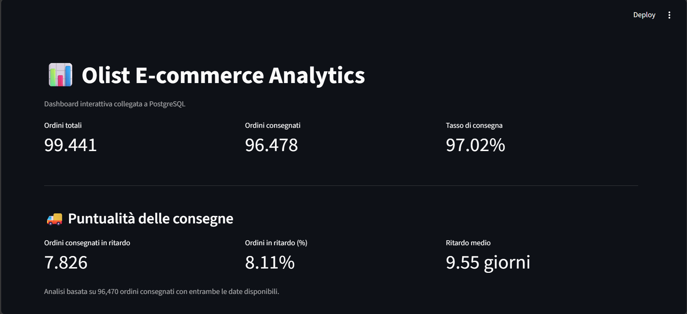
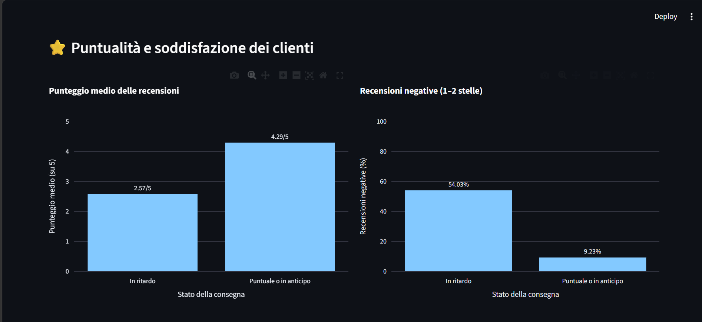

# Olist data engineering project

A small project I made to practice SQL, Python and PostgreSQL on real data. I took the Brazilian e-commerce dataset from Olist (it's on Kaggle), loaded it into a database, checked that the data was clean, wrote SQL queries to analyze it and built a dashboard with Streamlit.

## What it does

In order:

1. Reads the CSV files from the `data/` folder.
2. Creates the tables in PostgreSQL (`01_create_schema.sql`).
3. Runs the ETL (`03_etl.py`). It checks the source files, fixes the date columns, loads the tables in the right order and then compares the row counts.
4. Runs 17 data quality checks written in SQL: duplicates, broken links between tables, invalid values and a few other things.
5. Analyzes the data with SQL: orders, payments, reviews and delivery times.
6. Shows the results in a Streamlit dashboard with Plotly charts.

Tools: Python, pandas, PostgreSQL, SQLAlchemy, psycopg2, Streamlit, Plotly, python-dotenv and pytest.

## Dashboard

Main page:



Delivery analysis:



## What I found

I only looked at delivered orders that have delivery dates.

- 8.11% of them arrived later than the estimated date.
- Reviews are a lot worse when the order is late: the average score is 2.57 out of 5, against 4.29 for orders on time or early.
- 54.03% of the reviews for late orders are 1 or 2 stars. For the other orders it's 9.23%.

So late deliveries and bad reviews clearly go together. I can't say that the delay is the cause, the data only shows the link between the two.

All 17 quality checks passed in the run I used for this report.

## Files

```text
olist-data-engineering/
├── data/                       # CSV files from Kaggle (not in the repo)
├── src/                        # extra analysis scripts
├── tests/
│   └── test_data_quality.py    # test for the quality checks
├── 01_create_schema.sql        # creates the tables
├── 03_etl.py                   # ETL pipeline
├── 04_sql_analysis.sql         # business analysis queries
├── 05_dashboard.py             # Streamlit dashboard
├── 06_data_quality.py          # data quality checks
├── 07_delivery_analysis.sql    # delivery analysis
├── data_quality_report.csv     # report made by the quality checks
├── requirements.txt
├── .gitignore
└── README.md
```

## Run it yourself

You need Python 3.10 or newer, PostgreSQL and the dataset.

**1. Get the data.** Download the [dataset from Kaggle](https://www.kaggle.com/datasets/olistbr/brazilian-ecommerce), create a `data/` folder in the project root and put the CSV files in it. Don't rename them.

**2. Install the libraries.**

```bash
python -m pip install -r requirements.txt
```

**3. Set up the database.** Create a PostgreSQL database and a `.env` file in the project root:

```dotenv
DB_HOST=localhost
DB_PORT=5432
DB_NAME=Olist
DB_USER=postgres
DB_PASSWORD=your_local_password
```

Put your own password there. Don't commit the `.env` file.

**4. Create the tables.** Run `01_create_schema.sql` on your database, with pgAdmin or `psql`.

**5. Run the ETL.**

```bash
python 03_etl.py
```

A few things to know about it:

- It uses a database transaction, so if something goes wrong the data is not left half loaded.
- It does a full refresh: when a run works, the data in the tables it manages is replaced.
- It does not refresh the `customers` table, so that table must already have data.
- It writes logs and the run time in `etl.log`.

**6. Run the quality checks.**

```bash
python 06_data_quality.py
```

It runs the 17 checks and creates `data_quality_report.csv`. If a check fails, the script exits with an error.

**7. Run the tests.**

```bash
python -m pytest -v
```

The test checks that the quality script runs, creates the report and passes all 17 checks. For this PostgreSQL has to be running, the database must have data and the `.env` file must be correct.

**8. Start the dashboard.**

```bash
python -m streamlit run 05_dashboard.py
```

Then open the local link that shows up in the terminal.

## SQL analysis

The SQL files have queries and views about order status, delivery KPIs, the monthly value of delivered items, payment methods, the distribution of reviews, late delivery rates and delays, and review scores for late vs. on-time orders.

## What I want to do next

- Write tests for the single transformation functions.
- Schedule the ETL so it runs by itself.
- Put the project in Docker.
- Put the dashboard online.

## Data

Dataset: [Brazilian E-Commerce Public Dataset by Olist](https://www.kaggle.com/datasets/olistbr/brazilian-ecommerce). I made this project to learn and for my portfolio.
